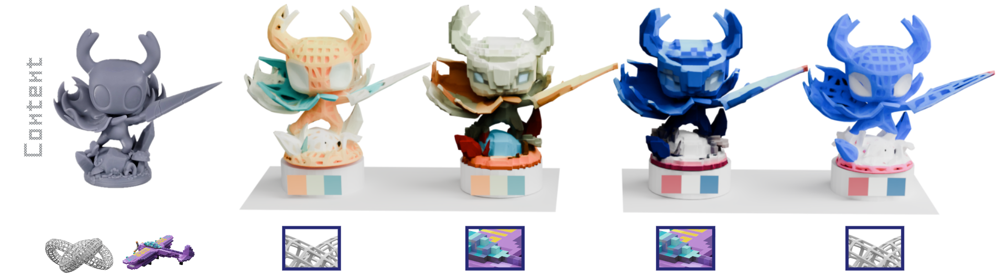

<div align="center">

# DiDE: Direct Injection with Color-Texture DEcoupling for 3D Stylization

### 🎉 Accepted to NeurIPS 2026

**Independent texture and color control for reference-guided 3D stylization**

[📄 arXiv](https://arxiv.org/pdf/2610.02044) · [🖼️ Teaser](#teaser) · [📝 Abstract](#abstract) · [💻 Usage](#usage) · [📚 Citation](#citation) · [✉️ Contact](#contact)

</div>

---

<a id="teaser"></a>
## 🖼️ Teaser

<p align="center">
  
</p>

<a id="abstract"></a>
## 📝 Abstract

Recent advances in image-to-3D generative models have enabled high-quality 3D asset generation and reference-guided stylization. However, existing approaches typically transfer texture and color jointly, limiting independent control over these attributes. We introduce **Disentangled 3D Stylization (Disen3D)**, a task that uses separate content, texture, and color references, and propose **DiDE**, a training-free framework built on TRELLIS. DiDE constructs a color-neutral texture carrier and uses dedicated appearance branches with channel partitioning to compose texture and color signals while preserving content geometry. The resulting source, texture-only, color-only, and joint endpoints support continuous control over both attributes. Experiments demonstrate effective disentangled appearance transfer and favorable human preference compared with existing 3D stylization methods.

<a id="usage"></a>
## 💻 Usage

### Installation

~~~bash
git clone https://github.com/tttao-uwu/DiDE.git
cd DiDE

# TODO: Add the verified environment and dependency installation commands.
~~~

### Run

~~~bash
# TODO: Add the verified inference command.
# Inputs: content image, texture reference, and color reference.
~~~

> 🚧 Code and detailed usage instructions coming soon.


<a id="citation"></a>
## 📚 Citation

If you find this work useful, please consider citing our paper.

```bibtex
@article{wu2026dide,
  title={DiDE: Direct Injection with Color-Texture DEcoupling for 3D Stylization},
  author={Wu, Tao and Gomez-Villa, Alexandra and Li, Senmao and Wang, Yaxing and van de Weijer, Joost and Wang, Kai},
  journal={arXiv preprint arXiv:2610.02044},
  year={2026}
}
```

<a id="contact"></a>
## ✉️ Contact

For questions or research discussions, please contact **[taowu@cvc.uab.es](mailto:taowu@cvc.uab.es)**.
